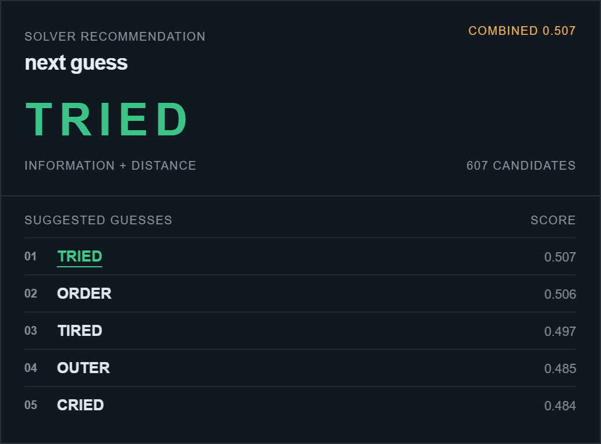

# wowdle

A Wordle solver in C++, with a Chrome side panel and eight strategies to compare.

Wowdle keeps every answer consistent with the tile colors, scores the next guess,
and shows the reasoning behind it. Its adaptive strategy changes the balance
between gathering information and trying to finish the game as candidates and
turns run out.

[Run & play](docs/guide.md) · [Algorithms](docs/algorithms.md) · [Time & space](docs/complexity.md) · [Code & architecture](docs/architecture.md) · [Benchmarks](docs/benchmarks.md)

*Actual output from the C++ WebAssembly backend after `YEARS → xyxyx`.*

## Play, inspect, compare

- **Manual:** enter the colors from any five-letter Wordle game. Pick the
  recommendation, choose another suggestion, or enter the word you played.
- **Auto:** sync the visible board on NYT Wordle, `wordleunlimited.com`, or
  `wordleunlimited.org`. Each Play click enters one guess and reads its feedback.
- **Analysis:** inspect entropy, expected survivors, worst case, feedback
  separation, answer likelihood, guess type, and the active weights.
- **Experiments:** let an isolated computer game choose the answer, run seeded
  batches, and export strategy summaries and every turn's scores.

The browser extension uses the adaptive strategy. All eight strategies are
available through the CLI and benchmark runner. C++ owns the solver; JavaScript
handles the interface and browser interaction.

## How it chooses

Every candidate is tested against the same duplicate-safe feedback engine. A word
survives only if it produces exactly the colors received. That rule stays the
same regardless of which strategy chooses the next guess.

The baselines use randomness, letter frequency, positional frequency, entropy,
expected remaining candidates, or minimax. The distance strategy measures how
different the resulting feedback would be for different candidate answers.
Adaptive combines information, separation, candidate reduction, likelihood, and
a penalty for information-only guesses, with different weights at different
stages of the game.

Answer probability and guess usefulness are separate. A word can be useful to
play even when previous feedback has already ruled it out as the answer.
[The algorithm notes](docs/algorithms.md) work through the formulas and a real
recommendation, including why a candidate has zero probe penalty.

## Measured results

One batch of **100 shared sampled answers per strategy**, using the bundled
16,131-word dictionary, six turns, a 100-word guess shortlist, frequency priors,
and seed 42:

| Strategy | Wins | Mean guesses, all games |
| --- | ---: | ---: |
| Random | 90/100 | 4.81 |
| Letter frequency | 97/100 | 4.53 |
| Positional frequency | 91/100 | 4.75 |
| Entropy | 98/100 | 4.46 |
| Expected candidates | 99/100 | 4.44 |
| Minimax | 98/100 | 4.64 |
| Feedback distance | 99/100 | 4.68 |
| Adaptive | 94/100 | 4.70 |

The mean includes failures, which use all six guesses. Expected candidates had
the lowest mean in this batch; adaptive's current defaults did not improve on
it. This is a small seeded comparison on a broad dictionary, not a result for
the official Wordle answer list. The weights remain experimental.

[Results and methodology](docs/benchmarks.md) include runtime, medians, probe
counts, the raw CSV, and the recorded run settings.

---

made with love (for wordle)

