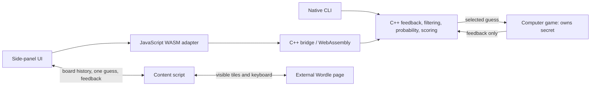

# Code and architecture

The project has two frontends: a native command-line program and a Chrome side
panel. Both call C++ scoring functions. The browser version runs them as
WebAssembly in the side panel; it does not need a local solver server.

For the mathematics, read [Algorithms](algorithms.md) and
[Time and space complexity](complexity.md). For commands and controls, read [Run & play](guide.md).

[File map](#file-map) · [WASM interface](#the-wasm-interface) · [Auto mode](#auto-mode-is-a-browser-transaction) · [State and exports](#state-persistence-and-analysis-exports) · [Tests](#tests-and-what-they-establish)

## The boundaries

The feedback engine knows nothing about entropy, Chrome, or the interface. A
strategy sees possible answers and the game state available to any player. In a
computer game, `ComputerGame` keeps the selected secret private from recommendation
functions. In browser mode,
the extension reads the visible board; it does not inspect the game's answer
variable or storage to discover the answer.

## File map

### C++ engine

| File | Responsibility |
| --- | --- |
| [`src/core/feedback.cpp`](../src/core/feedback.cpp) | `evaluate_feedback`: green-first, count-limited yellow allocation |
| [`src/core/candidate_filter.cpp`](../src/core/candidate_filter.cpp) | `filter_candidates`: replay feedback against each candidate and keep exact matches |
| [`src/probability/prior.cpp`](../src/probability/prior.cpp) | Load prior weights, normalize them over survivors, and rank possible answers |
| [`src/strategies/scoring.cpp`](../src/strategies/scoring.cpp) | Shared feedback-bucket metrics, letter/positional frequency, and baseline rankings |
| [`src/strategies/adaptive.hpp`](../src/strategies/adaptive.hpp) | `AdaptiveConfig`, component weights, thresholds, and `GuessAnalysis` |
| [`src/strategies/adaptive.cpp`](../src/strategies/adaptive.cpp) | Build the guess shortlist, select a stage, normalize metrics, and rank adaptive guesses |
| [`src/strategies/risk.cpp`](../src/strategies/risk.cpp) | Candidate membership and the urgency-adjusted probe penalty |
| [`src/strategies/entropy.cpp`](../src/strategies/entropy.cpp) | Standalone entropy functions and the earlier fixed entropy/likelihood combination |
| [`src/strategies/distance.cpp`](../src/strategies/distance.cpp) | Standalone word/feedback distances, weighted distance, pairwise separation, and bucket separation |

Headers alongside these files define their public functions. `scoring.cpp` is
the shared metric implementation used by the current adaptive and benchmark
paths. The older entropy and distance functions remain independently testable;
they are also useful reference implementations in tests. The earlier fixed
70/30 entropy/likelihood combination is no longer the production recommendation
rule.

### Native program and experiments

| File | Responsibility |
| --- | --- |
| [`src/main.cpp`](../src/main.cpp) | Parse CLI options, load dictionaries, handle manual feedback, and write experiment output |
| [`src/evaluation/benchmark.hpp`](../src/evaluation/benchmark.hpp) | `ComputerGame`, experiment options, game results, and summary types |
| [`src/evaluation/benchmark.cpp`](../src/evaluation/benchmark.cpp) | Choose strategies, run bounded games, sample answers, aggregate results, and write CSV traces |

`recommend_guesses` dispatches to the named baseline or adaptive strategy.
`play_game` submits that choice to a `ComputerGame`, receives feedback, and
filters its own candidate set. `run_benchmark` creates the common answer sample
and repeats that loop for each strategy. The secret is not an argument to
`recommend_guesses` or a scoring function.

### Browser extension

| File | Responsibility |
| --- | --- |
| [`extension/index.html`](../extension/index.html) | Side-panel layout, controls, help, recommendation list, and analysis fields |
| [`extension/style.css`](../extension/style.css) | Layout, colors, tile feedback, focus styles, and transitions |
| [`extension/app.js`](../extension/app.js) | Render C++ state, handle manual input/choices, synchronize the game, and export analysis |
| [`extension/backend.js`](../extension/backend.js) | Load WASM assets, call the C interface, parse JSON, and propagate errors |
| [`extension/content.js`](../extension/content.js) | Read visible boards, enter a guess, and wait for its rendered feedback |
| [`extension/background.js`](../extension/background.js) | Open the side panel from Chrome's toolbar action |
| [`extension/manifest.json`](../extension/manifest.json) | Extension entry points, supported hosts, permissions, and WASM-compatible CSP |
| [`extension/icons/wowdle.svg`](../extension/icons/wowdle.svg) | Editable logo source; PNG exports in the same folder serve the toolbar and extension menu |
| [`src/wasm/solver_bridge.cpp`](../src/wasm/solver_bridge.cpp) | Own one browser solver session and expose validated C calls returning JSON |

`extension/wowdle.js` and `extension/wowdle.wasm` are generated artifacts. Change
the C++ sources, then rebuild them; hand-editing the generated loader does not
change the solver source. The extension always uses adaptive scoring with the
default configuration. Strategy selection and configuration overrides are
currently CLI/C++ features.

## Startup and one manual turn

1. `SolverBackend.init` loads `wowdle.js`, creates its module, and fetches the
   extension's copies of the word list and frequency file.
2. `wowdle_init` normalizes five-letter alphabetic entries, removes duplicates,
   skips invalid word-list entries, reads weights, and starts a six-turn session.
3. `wowdle_recommend` builds a shortlist and returns recommendations, answer
   probabilities, and analysis. `app.js` renders that response and restores any
   saved manual history through `wowdle_restore`.
4. After a manual submission, `wowdle_submit` validates the word and colors,
   filters into a temporary candidate set, and rejects an empty result. Accepted
   feedback updates the candidates and history, then produces the next state.
5. All-green feedback produces `won`. Six accepted guesses without all green
   produce `lost`. A completed state has no next-guess recommendations.

Contradictory feedback does not consume a turn or replace the candidate set.
The UI presents the error and lets the player correct it. A C++ load or call
failure also stays visible; the UI does not substitute mock recommendations.

## The WASM interface

The exported functions in
[`solver_bridge.cpp`](../src/wasm/solver_bridge.cpp) are:

| Call | Input | Effect |
| --- | --- | --- |
| `wowdle_init` | Word-list text, frequency text | Replace the session's dictionaries and reset history |
| `wowdle_recommend` | None | Return the current state and recommendations |
| `wowdle_submit` | Guess, feedback string | Validate and apply one turn |
| `wowdle_restore` | Whitespace-separated `guess feedback` pairs | Rebuild a session from its complete history |

`wowdle_init` returns no JSON; the adapter checks initialization by calling
`wowdle_recommend`. Other calls return a pointer to a C++-owned response string.
`ccall` converts it immediately to a JavaScript string. The pointer is not a
durable handle and can change on the next call. This bridge owns one session,
not a collection of sessions keyed by ID.

Errors are JSON objects with an `error` string. Successful states include:

| Field | Meaning |
| --- | --- |
| `status` | `playing`, `won`, or `lost` |
| `guess` | Best next guess while playing; solved word on a win; empty on a loss |
| `candidates` | Number of possible answers |
| `dictionary_size`, `skipped_words` | Usable word count and rejected source entries |
| `guesses_remaining`, `max_guesses` | Turn budget; the extension uses six |
| `history` | Accepted `{guess, feedback}` pairs |
| `recommendations` | Up to five `{word, score, analysis}` entries |
| `analysis` | Analysis for the first recommendation, or `null` after the game ends |
| `answers` | Up to ten words ranked by candidate probability |

Each recommendation's analysis contains raw metrics, normalized components,
stage, probability, probe penalty, combined score, and active weights. The
browser can change its selected suggestion without rerunning the engine because
that suggestion's analysis is already in the response.

The displayed answer probabilities are normalized over **all** surviving
candidates. Only ten are returned, so their visible percentages need not add up
to 100%. Guess scores have a different meaning and are not probabilities.

`wowdle_restore` filters into temporary candidates and history before replacing
the current session. An impossible replay leaves the previous state intact.
Undo is a replay with the last turn removed; reset is a replay of an empty
history. No inverse-filtering rules are needed.

## Auto mode is a browser transaction

The side panel sends two message types to the active supported game tab:

| Message | Request | Successful response |
| --- | --- | --- |
| `WOWDLE_GET_BOARD` | No guess | Visible `history`, `currentGuess`, `maxGuesses`, `status`, and adapter information |
| `WOWDLE_PLAY_GUESS` | `guess` and exact `expectedHistory` | The played `guess`, its `feedback`, and updated board history |

`syncBoard` replays the board's completed rows through C++ when the history has
changed. Before Play, the app reads the board again and pins the returned tab ID
for the subsequent request. If synchronization changes the history, it updates
the recommendation and stops so the user can review it before pressing Play
again.

The content script then:

1. Confirms the board's exact history matches the request and the game is still
   playing. A matching row count alone is insufficient.
2. Rejects a conflicting partial word or an open game dialog. A fully typed word
   that already matches the requested guess may be submitted without retyping.
3. Uses visible on-screen keys where possible, with keyboard events as a
   fallback. It checks the row after entering each letter.
4. Waits for a new completed row, verifies that the row spells the requested
   word, and returns its colors only after the reveal has finished.
5. Reports a rejected word, changed board, or timeout and cleans up its
   observers and timers.

An in-flight flag prevents two simultaneous Play requests. A global injection
guard prevents duplicate message listeners. If the initial board-read listener
is missing, the app can inject the content script and retry that read once. It
does not automatically retry a failed Play message, because the first request
may already have entered a word.

### Supported board layouts

| Site/layout | DOM integration |
| --- | --- |
| NYT / modern Wordle | Row containers and tiles with rendered `data-state` values |
| `wordleunlimited.org` / legacy Wordle | Open shadow roots, `game-row`, `game-tile`, rendered inner tile state, custom modal and toast elements |
| `wordleunlimited.com` / WordPlay | Editable `.wp-cell` elements, completed flip cards, and its keyboard buttons |

All three translate the visible colors to `g`, `y`, and `x`. In the legacy
layout, the host's evaluation can be assigned before the staggered flip is
visible, so the adapter waits for the rendered shadow tile. This is why parsing
an attribute as soon as it appears can give the wrong impression of a completed
turn.

## State, persistence, and analysis exports

The C++ browser session contains dictionaries, weights, candidates, history, and
the response buffer. The JavaScript app contains the rendered response, selected
mode, busy flag, and the decision records collected during the current panel
session.

Manual history is saved under `wowdle-manual-history-v1` in the extension page's
local storage. On reopening the panel, that history is replayed through C++.
Auto mode instead takes its history from the game board and does not overwrite
the saved manual session.

The analysis download contains `history`, `turns`, and the latest `state`.
Recorded turns include the selected suggestion's analysis before submission.
After reopening or syncing, the original decision metrics for earlier turns are
not reconstructed. A manually entered word outside the recommendation list has
no precomputed analysis; its analysis fields are blank and its turn record uses
`null`. The C++ filtering still accepts valid feedback for that word.

The UI calls candidate membership **guess type**: `candidate` or
`information-only`. Numeric `risk` remains in the analysis JSON and scoring
formula. It measures the penalty for a known-impossible answer, not the chance
of a miss. See [the risk definition](algorithms.md#what-risk-means-here).

## Data and build artifacts

| Path | Role |
| --- | --- |
| [`data/wordlist_fives.txt`](../data/wordlist_fives.txt) | Source five-letter dictionary; used for both answers and guesses by default |
| [`data/word_frequencies_fives.txt`](../data/word_frequencies_fives.txt) | Generated corpus-frequency weights |
| [`tools/generate_frequency_data.py`](../tools/generate_frequency_data.py) | Run `wordfreq.word_frequency(word, "en")` for each source entry |
| [`tools/requirements.txt`](../tools/requirements.txt) | Optional Python dependency for regenerating frequencies |
| [`tools/README.md`](../tools/README.md) | Which development scripts to use and which artifacts to keep |
| [`tools/build.ps1`](../tools/build.ps1) | Build `.build/wowdle.exe` and optionally all local test suites |
| [`tools/build_wasm.ps1`](../tools/build_wasm.ps1) | Compile the bridge and active scoring sources, then copy data into the extension |
| [`tools/check_unlimited.cjs`](../tools/check_unlimited.cjs) | Optional live `.org` smoke test in an isolated headless Chrome profile |
| [`tools/build_icons.cjs`](../tools/build_icons.cjs) | Render the logo's PNG sizes from its SVG source using headless Chrome |

The source list has 16,152 entries. The current loaders skip 21 entries containing
punctuation, leaving 16,131 usable words. They preserve the source files.

The native loader accepts one consistent word length. The browser bridge
explicitly accepts five-letter ASCII words and six turns. Low-level feedback
functions assume alphabetic input; their direct callers must respect that
contract. Input validation at the CLI and bridge boundaries keeps punctuation
out of the 26-letter count array.

The WASM build enables C++ exceptions, a 1 MiB stack, and growing memory. Exceptions
allow ordinary invalid-input errors to become JSON responses. The larger stack
supports the C++ containers used in scoring. The browser build does not compile
the native CLI or benchmark runner.

## Tests and what they establish

| Test source | Main checks |
| --- | --- |
| [`test_feedback.cpp`](../tests/test_feedback.cpp) | Duplicate counts, green priority, mixed colors, case, and other lengths |
| [`test_candidate_filter.cpp`](../tests/test_candidate_filter.cpp) | Exact replay, duplicate letters, and invalid feedback length |
| [`test_prior.cpp`](../tests/test_prior.cpp) | Uniform probabilities, weighted ordering, fallback weights, and normalization |
| [`test_entropy.cpp`](../tests/test_entropy.cpp) | Manually checkable entropy and the earlier fixed combined ranking |
| [`test_distance.cpp`](../tests/test_distance.cpp) | Word/feedback Hamming, weighted feedback, pairwise and bucket separation |
| [`test_risk.cpp`](../tests/test_risk.cpp) | Candidate membership, turn urgency, and invalid inputs |
| [`test_scoring.cpp`](../tests/test_scoring.cpp) | Baseline rankings, bucket arithmetic, and agreement with independent older metric functions |
| [`test_adaptive.cpp`](../tests/test_adaptive.cpp) | Stages, configurable weights, normalization, tiny-set restrictions, and exact final-turn selection |
| [`test_benchmark.cpp`](../tests/test_benchmark.cpp) | Game budget, aggregation denominators, seeded repeats, common answers, endgame rules, and traces |
| [`test_bridge.cpp`](../tests/test_bridge.cpp) | Input validation, failed-feedback/replay state preservation, JSON fields, probabilities, and terminal states |
| [`test_content.js`](../tests/test_content.js) | Modern, legacy, and WordPlay fixtures; sync, animation, rejection, duplicate injection, timeout, and dialog behavior |
| [`test_extension.js`](../tests/test_extension.js) | Manual persistence, controls, domain permissions, syncing, message retries, and backend error handling |
| [`test_wasm.js`](../tests/test_wasm.js) | Load the generated loader/binary, parse real JSON, catch C++ errors, replay history, and solve a duplicate-letter game |

Fixture tests make browser behavior repeatable without a network connection.
The optional live test exercises `.org`'s actual DOM and a complete C++ solve.
A live game's outcome is not an aggregate benchmark, and fixtures cannot ensure
compatibility with every future version of an external site.

## Extending the project

To add a scoring strategy, keep it a C++ function over guesses and candidates,
give it small hand-verifiable tests, and connect its name in
`rank_baseline_guesses` and the evaluation dispatch. A new metric used by several
strategies belongs beside `calculate_guess_metrics`, rather than in the UI.

To change adaptive behavior, start with `AdaptiveConfig` and its tests. Changing
thresholds or weights changes the experiment; record the new settings and
evaluate on a fresh sample before interpreting a gain.

To support a new browser layout, update `content.js`, add the host to both the
manifest and `activeGameTab` checks, and add a fixture that matches the observed
DOM. Keep candidate filtering in C++. To replace corpus priors, change the
probability layer without changing the exact-feedback filter.

The current limitations worth knowing are the broad answer dictionary, heuristic
guess shortlist, fixed browser word length/turn budget, and lack of external
hard-mode enforcement. They are discussed where they affect
[playing](guide.md), [scoring](algorithms.md), and [measurement](benchmarks.md).
